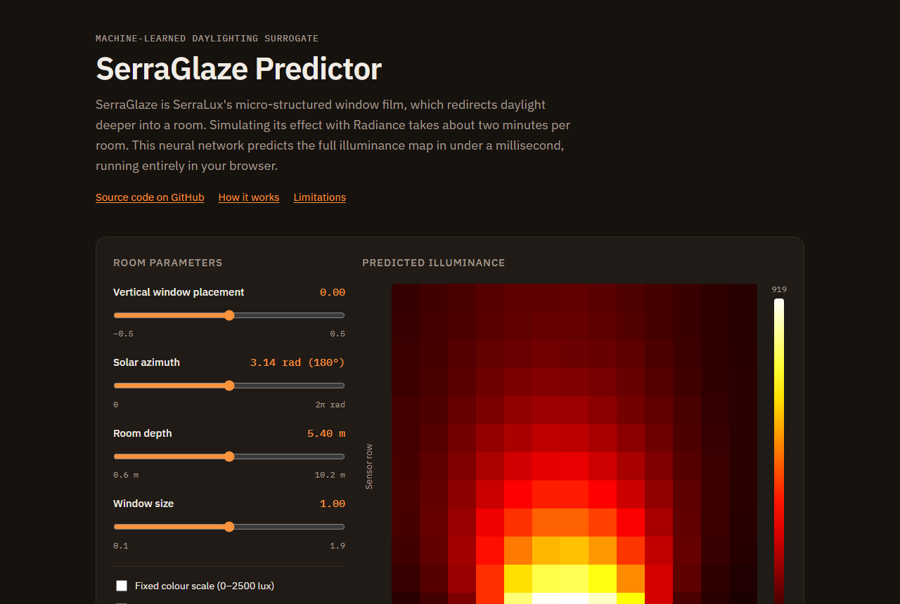

# SerraGlaze Predictor

A machine-learned surrogate for daylighting simulation. SerraGlaze is
SerraLux's window film, which redirects daylight deeper into a room.
Predicting its effect normally takes Radiance about two minutes per room;
this model does it in under a millisecond.

**Live app:** https://serraglaze.jackmarsters.com/ (runs entirely in your browser)

The original Streamlit version is still on Hugging Face:
https://orange-jacket-serraglaze-predictor.hf.space/

**Report:** [Predicting Daylighting Outcomes of SerraGlaze Using Machine Learning](report/SerraGlaze_ML_Report.pdf) (PDF)

## Results
Trained on 1,000 Radiance simulations and tested on 100 held-out ones.

| Model | Predicts | R² | Speed-up over Radiance |
|---|---|---|---|
| Neural network (PyTorch) | full 13 × 13 illuminance grid | 0.988 | ~4 × 10⁵ |
| XGBoost | average room illuminance | 0.986 | ~7 × 10⁶ |

Inputs: window size, vertical window placement, room depth and azimuth.

## How the model was built
The `training/` folder contains the full pipeline behind the deployed model:
parameter sampling, model training and evaluation.

### Sampling
Room configurations were drawn by Latin hypercube sampling over four
parameters: window size, vertical window placement, room depth and azimuth
angle (`training/latin_hypercube.py`).

### Data
1,000 Radiance simulations were generated in Grasshopper (Honeybee, the
SerraGlaze BSDF and a London EPW weather file). Each one gives the annual
average illuminance on a 13 × 13 sensor grid at working-plane height (0.8 m).
A further 100 runs, from a separate Latin hypercube sample, form a held-out
test set that is used only for the final scores. The simulation files are not
included.

### Models
- **Average illuminance (scalar):** linear regression, random forest and
  XGBoost (`linear_regression.py`, `random_forest.py`, `xgboost_model.py`).
- **Full 13 × 13 grid (spatial):** the outputs are standardised and compressed
  with PCA (99.3 % of variance, chosen by a sweep on an 800/200 split of the
  training set; see `pca_sweep_results.csv`), then a 4–128–256–128–n neural
  network predicts the PCA components (`dnn_pca.py`). This is the model in the
  web app.

### Evaluation
R² and RMSE on the 100 held-out runs:

| Model | Predicts | R² | RMSE (lux) |
|---|---|---|---|
| Linear regression | average illuminance | 0.741 | 68.5 |
| Random forest | average illuminance | 0.969 | 23.6 |
| XGBoost | average illuminance | 0.986 | 15.8 |
| Neural network + PCA | 13 × 13 illuminance grid | 0.988 | 17.9 |

Speed test on an Intel i7-11800H: XGBoost takes about 18 µs per prediction
and the full neural-network pipeline about 0.32 ms, against about 2 minutes
for one Radiance simulation (`scalar_speedtest.py`, `dnn_speedtest.py`).

`noise_floor.py` is a preliminary analysis of Radiance's run-to-run noise,
using repeated simulations of the same configurations. It is not part of the
report.

### Reproducing
Put the simulation files in `data/`, then from the repo root:

    pip install -r training/requirements.txt
    python training/linear_regression.py
    python training/random_forest.py
    python training/xgboost_model.py
    python training/dnn_pca.py
    python training/scalar_speedtest.py
    python training/dnn_speedtest.py

Trained models are written to `training/outputs/` (not tracked by git), so
retraining never overwrites the deployed model in `model/`.

### Data availability
Simulation data belongs to SerraLux and is not included.

## Limitations
- Validated against Radiance simulations, not physical measurements.
- Azimuth is not encoded as periodic, so 0 and 2π differ by about 7%.
- At some extreme settings the network predicts slightly negative illuminance
  for a few sensors. The web app shows these as 0 lux.

## Repository layout

    docs/       static web app, served by GitHub Pages
                (index.html, serraglaze-model.js, model.json)
    model/      deployed model: network weights (serraglaze_dnn_weights.pth)
                and preprocessing pipeline (pipeline.joblib: scalers + PCA)
    training/   sampling, training and evaluation scripts, figures
    tools/      export model/ to docs/model.json and check the JavaScript
                against PyTorch
    report/     the project report (PDF)
    app.py      the Streamlit app

The flow is: `training/` produces `model/`, `tools/` exports it to
`docs/model.json`, and `docs/` runs it in the browser.

## Running it
Web app: serve the repo root and open `/docs/`, for example

    python -m http.server
    # then visit http://localhost:8000/docs/

Streamlit app:

    pip install -r requirements.txt
    streamlit run app.py

## Updating the web model
After retraining, copy the new `serraglaze_dnn_weights.pth` and
`pipeline.joblib` from `training/outputs/` into `model/`, then regenerate the
browser model and check it still matches:

    python tools/export_model.py
    python tools/make_test_cases.py
    # serve the repo root and open /tools/verify.html: it should say PASS

The JavaScript matches a float64 evaluation of the network to about 1e-12 lux,
and PyTorch to within PyTorch's own float32 rounding (about 3e-4 lux).

## Context
Final-year industrial project with SerraLux, University of Oxford Department
of Physics, 2025–26. Awarded the Department of Physics prize for best group
project presentation.

### Authorship
Simulations, models, training and the report are my own work, completed for
the 2025–26 project. In November 2026, after assessment, I used Claude Code to
port the model to the browser and to tidy this repository for publication
(file layout, paths, comments, README). Models and results are unchanged.

## Licence
Code is MIT-licensed (see `LICENSE`). The SerraGlaze BSDF and simulation data
belong to SerraLux and are not covered by this licence.
